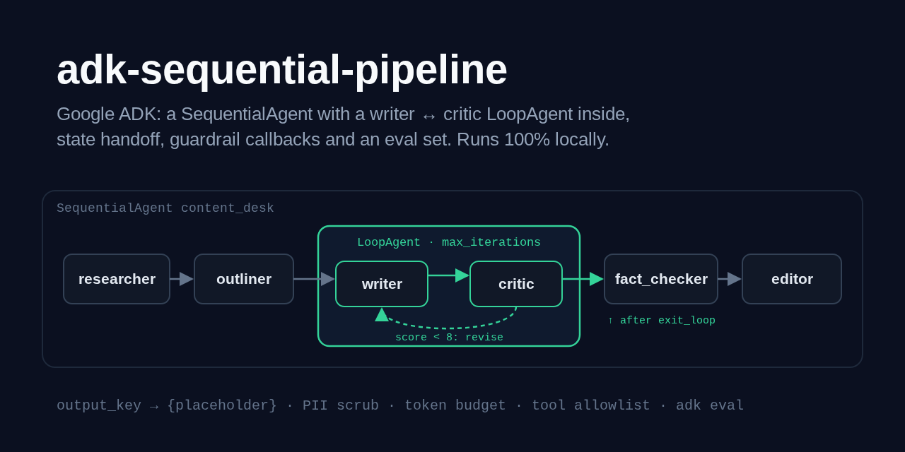
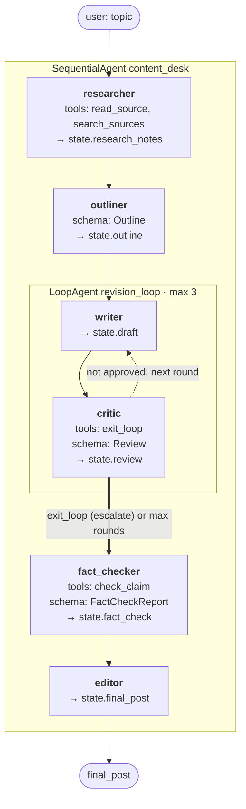

# adk-sequential-pipeline

> The sequential pipeline and the generator↔critic loop in Google's
> [Agent Development Kit](https://adk.dev): a **content desk** that turns a topic and a
> bundled folder of local sources into a reviewed, fact-checked, cited blog post.
> `SequentialAgent[researcher → outliner → LoopAgent[writer ↔ critic] → fact_checker → editor]`,
> state handed over through `output_key` and `{placeholder}` instructions, guardrails as
> model and tool callbacks, an ADK eval set, and a `root_agent` that `adk web`,
> `adk run` and `adk eval` load as is.

[](https://github.com/MartinCastroAlvarez/adk-sequential-pipeline/actions/workflows/ci.yml)
[](LICENSE)
[](pyproject.toml)
[](https://pypi.org/project/google-adk/)
[](pyproject.toml)



**Runs 100% locally, no paid APIs required.** Every agent's default model is an
open-weight model on [ollama](https://ollama.com) (`qwen3:4b`) through ADK's
`LiteLlm(model="ollama_chat/qwen3:4b")` wrapper, on loopback. The researcher can only
read the Markdown files in [`content_desk/sources/`](content_desk/sources) (or a folder
you point it at); there is no web search. Gemini is an optional switch you flip with your
own key. Tests, the demo, the eval set and CI use stub `BaseLlm` models: no model, no
key, no network.

## Why

- **Most "agent" work is a pipeline.** Research, plan, write, review, check, polish:
  the order is known, so a `SequentialAgent` runs it without an LLM deciding who goes
  next. That is cheaper, testable and the same every time.
- **Quality comes from a loop with a stop rule.** A writer and a critic take turns in a
  `LoopAgent` until the critic's rubric score passes a threshold (it calls `exit_loop`,
  which escalates) or the rounds run out (`max_iterations`). Both exits are tested.
- **Agents talk through state, not chat.** Each agent writes one key with `output_key`;
  the next reads it with a `{placeholder}` in its instruction and
  `include_contents="none"`, so it sees exactly its inputs and nothing else.
- **Guardrails belong in code.** Callbacks scrub PII before any model sees a prompt,
  enforce a token budget, refuse tool calls outside a per-agent allowlist, and stop the
  critic from ending the loop with a failing score.
- **Grounding is checkable.** The fact-checker sends every sentence of the draft to a
  `check_claim` tool that looks for a source sentence backing it; the editor removes
  what nothing supports.

## Quickstart

```bash
pip install "adk-sequential-pipeline @ git+https://github.com/MartinCastroAlvarez/adk-sequential-pipeline"
ollama pull qwen3:4b
python -m content_desk "SQLite write-ahead logging"            # the whole desk, on ollama
python -m content_desk --provider stub --transcript "SQLite WAL"   # offline, with the trace
DESK_PROVIDER=stub adk web .                                   # from a clone: ADK's dev UI
```

`--json` prints the post plus the outline, every review, the fact-check report and the
guardrail log; `--mermaid` prints the agent graph below; `--sources DIR` uses your own
Markdown notes. `python -m examples.quickstart` runs the desk offline and checks it.

## The pipeline

`python -m content_desk --mermaid`, generated from the real agent tree and pasted
unchanged:



| Agent | Kind | Reads (placeholders) | Tools | Writes (`output_key`) |
| --- | --- | --- | --- | --- |
| `content_desk` | `SequentialAgent` | the user message (`before_agent_callback` → `topic`) | | `topic` |
| `researcher` | `LlmAgent` | `{topic}` | `search_sources`, `read_source` | `research_notes` |
| `outliner` | `LlmAgent`, `output_schema=Outline` | `{topic}`, `{research_notes}` | | `outline` (+ `outline_text`) |
| `revision_loop` | `LoopAgent`, `max_iterations=3` | | | |
| `writer` | `LlmAgent` | `{outline_text}`, `{research_notes}`, `{review_text?}` | | `draft` |
| `critic` | `LlmAgent`, `output_schema=Review` | `{outline_text}`, `{draft}` | `exit_loop` | `review` (+ `review_text`) |
| `fact_checker` | `LlmAgent`, `output_schema=FactCheckReport` | `{draft}` | `check_claim` | `fact_check` (+ `fact_check_text`) |
| `editor` | `LlmAgent` | `{draft}`, `{fact_check_text}`, `{research_notes}` | | `final_post` |

## A run, step by step

`python -m content_desk --provider stub --transcript "SQLite write-ahead logging"`.
**This transcript comes from the offline stub model (`OfflineDeskModel`), not an LLM:**
it copies facts from the sources instead of writing prose, and its first sentence is a
claim no source supports, planted so the fact-checker has something to catch. The tool
calls, state writes, the second round and the loop's exit are the real ADK run. Ten
`check_claim` lines are folded into one:

~~~text
[researcher] -> search_sources({"query": "SQLite write-ahead logging"})
[researcher] <- search_sources: {"results": [{"source_id": "wal-basics", "title": "SQLite write-ahe...
[researcher] -> read_source({"source_id": "wal-basics"})
[researcher] -> read_source({"source_id": "wal-checkpoints"})
[researcher] -> read_source({"source_id": "wal-concurrency"})
[researcher] <- read_source: {"source_id": "wal-basics", "title": "SQLite write-ahead logging, t...
[researcher] <- read_source: {"source_id": "wal-checkpoints", "title": "Checkpoints and WAL file...
[researcher] <- read_source: {"source_id": "wal-concurrency", "title": "Readers and writers in W...
[researcher] state['research_notes'] = ## [wal-basics] SQLite write-ahead logging, the basics - SQLite normally protects a tra...
[outliner] state['outline'] = {"title": "A practical guide to SQLite write-ahead logging", "sections": [{"heading": "...
[writer] state['draft'] = # A practical guide to SQLite write-ahead logging Turning on SQLite write-ahead logging...
[critic] -> set_model_response({"score": 6, "rubric": {"coverage": 3, "citations": 0, "structure":...)
[critic] <- set_model_response: {"score": 6, "rubric": {"coverage": 3, "citations": 0, "structure":...
[critic] state['review'] = {"score": 6, "rubric": {"coverage": 3, "citations": 0, "structure": 1, "length": 2}, "i...
[writer] state['draft'] = # A practical guide to SQLite write-ahead logging Turning on SQLite write-ahead logging...
[critic] -> set_model_response({"score": 9, "rubric": {"coverage": 3, "citations": 3, "structure":...)
[critic] -> exit_loop({})
[critic] <- set_model_response: {"score": 9, "rubric": {"coverage": 3, "citations": 3, "structure":...
[critic] <- exit_loop: {"result": null}
[critic] escalate: the loop ends here
[critic] state['review'] = {"score": 9, "rubric": {"coverage": 3, "citations": 3, "structure": 1, "length": 2}, "i...
[fact_checker] -> check_claim({"claim": "Turning on SQLite write-ahead logging makes every databa...)
[fact_checker] -> check_claim({"claim": "SQLite normally protects a transaction with a rollback j...)
  ... 8 more check_claim calls, then their 10 results ...
[fact_checker] -> set_model_response({"claims": [{"claim": "Turning on SQLite write-ahead logging makes ...)
[fact_checker] <- set_model_response: {"claims": [{"claim": "Turning on SQLite write-ahead logging makes ...
[fact_checker] state['fact_check'] = {"claims": [{"claim": "Turning on SQLite write-ahead logging makes every database workl...
[editor] state['final_post'] = # A practical guide to SQLite write-ahead logging What follows is taken from the cited ...

# A practical guide to SQLite write-ahead logging

What follows is taken from the cited sources only.

## SQLite write-ahead logging, the basics

SQLite normally protects a transaction with a rollback journal that copies the original pages before they change [wal-basics]. In write-ahead logging mode, SQLite leaves the database file alone during a write and appends the changed pages to a separate file with the -wal suffix [wal-basics]. A transaction commits when a commit record is appended to the WAL file, so a commit can happen without touching the main database file [wal-basics].

## Checkpoints and WAL file growth

By default SQLite runs an automatic checkpoint when the WAL file reaches 1000 pages [wal-checkpoints]. The PRAGMA wal_autocheckpoint setting changes that threshold, and a value of zero turns automatic checkpoints off [wal-checkpoints]. The PRAGMA wal_checkpoint statement runs a checkpoint by hand in one of four modes: PASSIVE, FULL, RESTART or TRUNCATE [wal-checkpoints].

## Readers and writers in WAL mode

In WAL mode, readers do not block writers and a writer does not block readers [wal-concurrency]. Each reader works from a snapshot: it records the last valid commit in the WAL file when its transaction starts and ignores commits appended after that point [wal-concurrency]. There is still only one writer at a time, because all writes append to the same WAL file [wal-concurrency].

## Sources

- [wal-basics] SQLite write-ahead logging, the basics
- [wal-checkpoints] Checkpoints and WAL file growth
- [wal-concurrency] Readers and writers in WAL mode
~~~

Round 1 scored 6/10 (no citations), so the loop went round again with the critic's
issues templated into the writer's `{review_text?}`. Round 2 scored 9/10, and the critic
called `set_model_response` and `exit_loop` in the same turn, which escalated out of the
`LoopAgent`. The fact-checker flagged the planted sentence ("Turning on SQLite
write-ahead logging makes every database workload faster.") as unsupported, and the
editor dropped it.

## How it works

### State handoff: `output_key` in, `{placeholder}` out

```python
LlmAgent(name="writer", output_key="draft", include_contents="none",
         instruction="... <outline>{outline_text}</outline> ... <review>{review_text?}</review> ...")
```

ADK stores an agent's final text under `output_key` (for an `output_schema` agent, the
validated dict). Before each model call it fills `{key}` from session state; `{key?}`
renders an absent key as an empty string, which is how the first draft has no review.
Templating a dict would paste its Python repr, so each structured agent has an
`after_agent_callback` (`content_desk/views.py`) that also writes a short Markdown view
(`outline_text`, `review_text`, `fact_check_text`): code reads the dicts, prompts read
the views. Every downstream agent uses `include_contents="none"`, so it sees its
instruction and its own tool calls, not the researcher's tool chatter.

### The loop and its two exits

The critic has `output_schema=Review` **and** a tool, `exit_loop`. ADK's `LiteLlm`
reports `output_schema_and_tools=False` for ollama models (no response schema next to
tools), so ADK adds its `set_model_response` tool and asks the model to deliver the verdict through it. The
instruction says: when `score >= threshold`, call `exit_loop` in the same turn.
`exit_loop` sets `tool_context.actions.escalate = True`, and the `LoopAgent` stops after
the critic's turn. If no round passes, `max_iterations` ends the loop and the last draft
goes on to the fact-checker with `review.approved == false` for anyone to see.

A small model can call `exit_loop` while scoring 5/10. The critic's
`after_model_callback` (`exit_guard`) reads the verdict from the same response and
removes the `exit_loop` call unless `score >= threshold and approved`; the loop keeps
going and `guardrail_events` records why.

### Guardrails (callbacks)

| Callback | Where | What it does |
| --- | --- | --- |
| `before_agent_callback=capture_topic` | root | the user message becomes `state["topic"]`: whitespace-collapsed, capped at 200 chars, PII-redacted, `<>{}` neutralized; the previous run's keys are cleared |
| `before_model_callback` | every agent | redacts emails, API keys, card/SSN/phone numbers and IPs in the system instruction and contents; refuses a request over `max_request_tokens` and a run over `max_run_tokens` (`BudgetExceededError`, the model is never called) |
| `after_model_callback` | every agent | redacts the model's text before it reaches state; counts tokens |
| `exit_guard` (after model) | critic | drops `exit_loop` without a passing verdict in the same turn |
| `before_tool_callback` | every agent | per-agent allowlist; any other tool gets `{"error": ...}` back and never runs |

Tool allowlist (`content_desk.pipeline.TOOL_ALLOWLIST`): researcher → `search_sources`,
`read_source`; critic → `exit_loop`, `set_model_response`; fact_checker → `check_claim`,
`set_model_response`; everyone else → nothing.

### Tools over local sources only

`search_sources(query)` ranks the pack's notes by term overlap; `read_source(source_id)`
takes an id (`[a-z0-9-]`, the file stem), never a path, so `../../etc/passwd` is an
error, not a read; `check_claim(claim)` returns the single source sentence covering the
largest share of the claim's content words and calls it supported at
`DESK_SUPPORT_THRESHOLD` (0.6). That check is lexical: it rejects claims no sentence
backs, it can't catch a sentence that reuses a source's words to say something else.
The pack is loaded once, symlinks are skipped, files are capped at 64 KB, and its text
is neutralized (`<`, `>`, `{`, `}`) before it can reach a prompt.

### `adk web`, `adk run`, `adk eval`

`content_desk/agent.py` defines `root_agent`, the layout ADK's loaders expect, so from
a clone:

```bash
DESK_PROVIDER=stub adk web .                          # pick content_desk in the UI
DESK_PROVIDER=stub adk run content_desk "SQLite WAL"  # one turn in the terminal
DESK_PROVIDER=stub adk eval content_desk evals/content_desk.evalset.json \
    --config_file_path evals/test_config.json
```

Drop `DESK_PROVIDER=stub` to use ollama. The eval set
([`evals/content_desk.evalset.json`](evals/content_desk.evalset.json)) has two cases
recorded from the stub; [`evals/test_config.json`](evals/test_config.json) asks for
`tool_trajectory_avg_score` 1.0 (`IN_ORDER`: search, the expected reads, `exit_loop`)
and `response_match_score` (ROUGE-1) 0.8 against the recorded post. Both metrics run
locally; nothing is sent to Vertex. `tests/test_eval.py` runs the same set through
`AgentEvaluator` and proves a wrong trajectory fails it. With a real model, keep the
trajectory metric and lower `response_match_score`, or add ADK's LLM-judged metrics
(they need a judge model, which this repo never calls).

### Why `SequentialAgent` and `LoopAgent` in ADK 2.x

ADK 2.0 introduced graph-based `Workflow`s and marks the template workflow agents
deprecated in Python, while noting that a `Workflow` can't yet be an `LlmAgent`
sub-agent. The classic agents are still the documented, stable way to express this
pattern, and the one most readers will meet in existing code; the deprecation warning
is filtered at construction only (`content_desk/pipeline.py`). Porting the same tree
to a `Workflow` is a contained change: the agents, callbacks and state keys stay.

## When to use this pattern / trade-offs

Use a **sequential pipeline** when the steps and their order are known and each step
has one job: content production, ETL with judgment, report generation, code-review
checklists. Add a **generator↔critic loop** where quality is measurable (a rubric, a
test, a validator) and one more round is cheaper than a bad output.

| Choice | Gain | Cost |
| --- | --- | --- |
| Fixed order (`SequentialAgent`) | deterministic, debuggable, each agent small | can't skip or reorder steps; one weak step degrades every later one |
| Writer↔critic `LoopAgent` | measurably better drafts; explicit stop rule | up to `2 × max_iterations` extra model calls; a lenient critic approves too early, a harsh one never does |
| `exit_loop` from the critic | the model decides "good enough" | needs a guard: small models call it with failing scores |
| `max_iterations` | bounded cost and latency | the last draft may be unapproved; surface `review.approved` |
| State + `include_contents="none"` | small prompts, no cross-talk, clear contracts | an agent can't see context you didn't template in |
| `output_schema` | typed, validated handoffs | with tools on ollama it needs ADK's `set_model_response` workaround; a malformed answer fails the run |
| Lexical `check_claim` | fast, free, explainable | misses paraphrases and subtle misreadings; an LLM judge (or NLI model) is the next step |
| Callbacks as guardrails | enforced in code, not in the prompt | heuristics (regex PII, 4 chars per token) need tuning per domain |

Reach for `ParallelAgent` (fan-out) when steps are independent, and an LLM router or a
supervisor when the next step depends on the content.

## Configuration

| Variable | Default | Meaning |
| --- | --- | --- |
| `DESK_PROVIDER` | `ollama` | `ollama`, `gemini` (your key) or `stub` (offline) |
| `DESK_MODEL` | `qwen3:4b` / `gemini-3.5-flash` | model id for the provider; ollama ids become `ollama_chat/<id>` |
| `OLLAMA_HOST` | `http://127.0.0.1:11434` | passed to LiteLLM as `api_base`; must be loopback unless the next variable is `1` |
| `DESK_ALLOW_REMOTE_OLLAMA` | unset | `1` allows a non-loopback ollama |
| `DESK_TEMPERATURE` | `0` | sampling temperature for every agent |
| `DESK_MAX_ITERATIONS` | `3` | writer/critic rounds (`LoopAgent.max_iterations`), 1-10 |
| `DESK_APPROVAL_THRESHOLD` | `8` | critic score (0-10) that may end the loop |
| `DESK_MAX_REQUEST_TOKENS` | `6000` | budget for one model call (approximate, 4 chars per token) |
| `DESK_MAX_RUN_TOKENS` | `60000` | budget for one whole run |
| `DESK_SUPPORT_THRESHOLD` | `0.6` | share of a claim's words one source sentence must contain |
| `DESK_SOURCES` | bundled pack | folder of `*.md` notes (`title:` front matter optional) |
| `GOOGLE_API_KEY` | unset | only for `DESK_PROVIDER=gemini`; read by ADK, never by this package |

```python
import asyncio
from content_desk import Settings, build_pipeline, run_desk

root = build_pipeline(Settings.from_env())          # or models={"writer": ..., ...}
result = asyncio.run(run_desk("SQLite write-ahead logging", root=root))
print(result.final_post, result.state["review_history"], result.guardrail_events)
```

`build_pipeline(settings, models=...)` takes a mapping or factory from agent name to a
model (any `BaseLlm` or model id), so each agent can run a different model.

## Testing

```bash
poetry install && poetry run pytest          # 102 tests, 98% coverage, offline
```

Every test drives the real ADK `Runner` + `InMemorySessionService` with `ScriptedLlm`, a
`BaseLlm` subclass that plays a script per agent and records every request, or with
`OfflineDeskModel` for whole runs:

- **order and handoff:** the tree's shape; agents run researcher → outliner → (writer →
  critic) × n → fact_checker → editor; every `output_key` lands in state; each
  `{placeholder}` renders the previous agent's output into the next prompt; the writer's
  second prompt contains the critic's issues; state-only agents never see tool chatter;
- **the loop:** exits on the first approval (one writer call); stops at
  `max_iterations` (1, 2, 3, 5) with no approval and still reaches the editor; `exit_loop`
  next to a failing or lying score, or without a verdict, is dropped by the guard;
- **guardrails:** a tool outside the allowlist never runs and the model gets an error;
  the allowlist is per agent; PII in the topic or a model's output never reaches a
  later prompt or state; request and run budgets stop the run before the model is
  called; a second topic in one session starts clean;
- **grounding:** `check_claim` supports copied facts and rejects the planted claim; the
  fact-checker flags exactly that sentence across topics; the editor removes it and
  lists only real source ids;
- **sources:** hostile ids (`../`, `/etc/passwd`, `.md`, spaces), symlinks, oversized
  files and odd names are refused;
- **ADK compatibility:** `content_desk.agent.root_agent` loads; `AgentEvaluator` passes
  the eval set and fails a wrong trajectory; CI also runs `adk run`, `adk eval` and
  `adk web` (an HTTP `/run` call) on the stub;
- **hygiene:** no `eval`/`exec`/`pickle`/`subprocess`/`shell=`, no silenced lint or
  type findings, tools take ids and text but never paths, instructions template only
  known state keys.

## Part of the series

| Repo | Framework | Architecture |
|---|---|---|
| [langgraph-parallel-agents](https://github.com/MartinCastroAlvarez/langgraph-parallel-agents) | LangGraph | Parallelization / map-reduce (fan-out, fan-in) |
| [langgraph-plan-and-execute](https://github.com/MartinCastroAlvarez/langgraph-plan-and-execute) | LangGraph | Planning (plan → execute → replan) |
| [langgraph-reflection-agent](https://github.com/MartinCastroAlvarez/langgraph-reflection-agent) | LangGraph | Reflection (Reflexion: draft → critique → revise) |
| [langgraph-short-long-term-memory](https://github.com/MartinCastroAlvarez/langgraph-short-long-term-memory) | LangGraph | Memory: short-term (checkpointer) vs long-term (store) |
| ✅ **adk-sequential-pipeline** | Google ADK | Sequential pipeline + generator↔critic loop |
| [adk-vertex-memory-bank](https://github.com/MartinCastroAlvarez/adk-vertex-memory-bank) | Google ADK | Long-term memory (Vertex AI Memory Bank) |
| [adk-vertex-vector-search](https://github.com/MartinCastroAlvarez/adk-vertex-vector-search) | Google ADK | Agentic RAG (Vertex AI Vector Search) |
| [crewai-hierarchical-planning](https://github.com/MartinCastroAlvarez/crewai-hierarchical-planning) | CrewAI | Hierarchical / supervisor with planning |
| [langchain-tag-agent](https://github.com/MartinCastroAlvarez/langchain-tag-agent) | LangChain | Tool-using ReAct agent with Table-Augmented Generation (TAG) |
| [langsmith-agent-evals](https://github.com/MartinCastroAlvarez/langsmith-agent-evals) | LangSmith + LangGraph | Evaluation / observability, LLM-as-judge critic |
| [agentic-architectures](https://github.com/MartinCastroAlvarez/agentic-architectures) | framework-free | Catalog: ReAct, router, sequential, parallel, loop, reflection, critic, planning, supervisor, swarm/handoff, debate, human-in-the-loop, memory |
| [s3-agent-memory](https://github.com/MartinCastroAlvarez/s3-agent-memory) | LangGraph store | Agent memory (long-term, S3) |
| [agent-model-router](https://github.com/MartinCastroAlvarez/agent-model-router) | — | Router |

More from the same author: [local-rag-ollama](https://github.com/MartinCastroAlvarez/local-rag-ollama) ·
[ui-review-agent](https://github.com/MartinCastroAlvarez/ui-review-agent) ·
[pytest-llm-evals](https://github.com/MartinCastroAlvarez/pytest-llm-evals) ·
[repo-graph-mcp](https://github.com/MartinCastroAlvarez/repo-graph-mcp) ·
[agent-lint](https://github.com/MartinCastroAlvarez/agent-lint) ·
[django-admin-mcp-api](https://github.com/MartinCastroAlvarez/django-admin-mcp-api).

## Contributing

See [`CONTRIBUTING.md`](CONTRIBUTING.md), [`ARCHITECTURE.md`](ARCHITECTURE.md),
[`SECURITY.md`](SECURITY.md) and the agent contract in [`CLAUDE.md`](CLAUDE.md).

## License

MIT © 2026 Martín Castro Álvarez. See [LICENSE](LICENSE).
